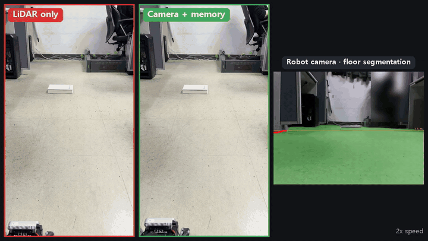
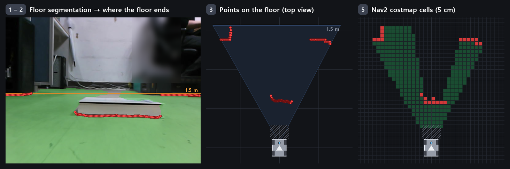
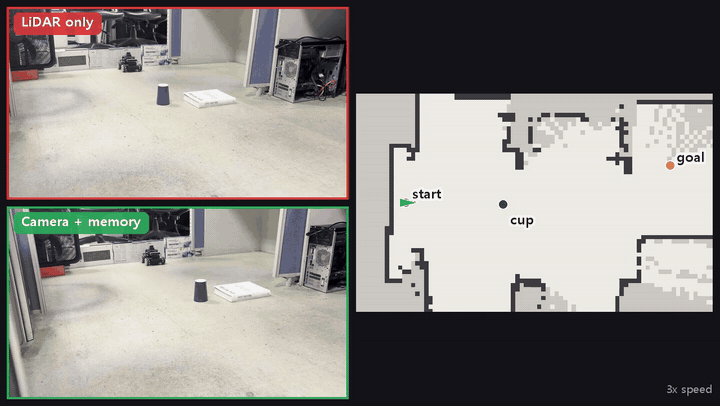
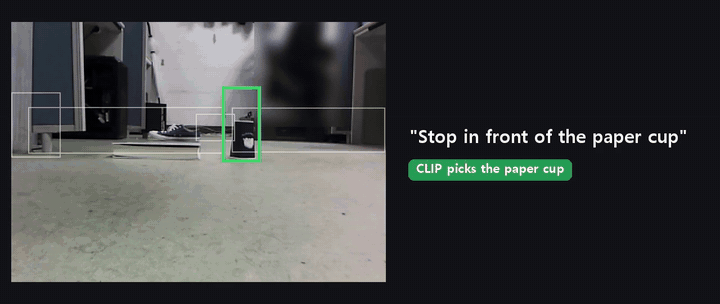

# Floor Vision Robot: Low-Obstacle Detection on a Raspberry Pi 5 Robot

2D LiDAR가 못 보는 낮은 장애물(책, 컵, 신발, 케이블)을 카메라를 이용한 floor segmentation으로 찾아서 Nav2에 넣었다.
로봇은 MentorPi M1(Raspberry Pi 5, NPU 없음)을 이용하였고, segmentation 모델은 내가 연구에서 제안한 모델 DS-Net(약 3.7M 파라미터)을 연구실 바닥 시점에 맞게 fine-tuning해 Pi 5 CPU에서 INT8로 돌렸다.

해당 2D LiDAR는 바닥에서 16 cm 높이의 바닥과 평행한 면을 훑는다. 그보다 낮은 물건은 지도에도 코스트맵에도 반영이 안 되기 때문에, 처음 Nav2를 돌렸을 때 바닥의 낮은 물체를 그대로 밀고 갔다. COCO로 pretrain한 detection model(YOLO11n)은 학습에 이용한 데이터셋과 지금 상황이 맞지 않아 낮은 물체를 거의 못 잡았다(domain shift 발생). 주행에는 물체가 무엇인지 맞히는 대신 바닥인지 아닌지만 보기만 해도 되기 때문에 바닥이 아니면 장애물로 보게끔 접근하였다.

## 동작

1. 카메라 영상(640×480)을 240×320으로 줄여 floor 여부에 따라 나눈다. 해당 해상도는 INT8 ONNX Runtime으로 Pi 5에서 한 장 추론하는 데 90 ms 정도가 소요된다.
2. 해당 장면의 column마다 아래에서 위로 올라가며 바닥이 처음 끊기는 point를 찾는다.
3. 카메라 높이와 각도 정보를 이용해서 그 point를 로봇 앞 바닥 좌표(m)로 바꿔 point cloud를 만든다.
4. 카메라 바로 앞(로봇 중심에서 0.29 m 안)은 화면에 안 보여서, 봐 둔 point를 odom 좌표로 기억해 두고 사각지대 안에서도 멈출 수 있게 했다.
5. Nav2 코스트맵(local, global)과 Collision Monitor가 이 point를 쓴다. 만약, 인식 노드(floor_seg_node)가 0.6초 넘게 반응이 없다면 감시 노드(floor_watchdog)가 로봇을 세운다(안전장치).

코스트맵에서 칸을 지우는 방법과 사각지대 기억은 [robot 문서](robot/README.md#토픽)의 그림으로 정리했다.

## Test result (2026-10-31 실제 주행)

| Test | LiDAR only | Camera with blind-spot memory |
|---|---|---|
| 직진 후 장애물 앞에서 정지 (1.5 m 앞 흰 책, 초속 10 cm) | 충돌 | 34 cm 앞부터 감속하고 정지 |
| 목표 지점까지 주행 (낮은 장애물 사이, 최고 초속 25 cm) | 장애물을 밀고 도착 | 충돌 없음 (6번 중 2번 도착) |

| | |
|---|---|
| 바닥 IoU | Fine-tuning 전 0.70 → 0.96 |
| 물체 접지선 recall | Fine-tuning 전 0.65\~0.71 → 0.90\~0.96 |
| Pi 5 추론 (240×320, 2스레드) | FP32 141 ms → INT8 양자화 + GELU fusion 84 ms |
| Reliable detection range (흰 책 기준) | 약 1.3 m |
| PC로 추론을 넘겼을 때의 지연 (주행 중, Wi-Fi) | 137~146 ms → 38 ms, 연결이 끊기면 0.63초 만에 정지 |
| 불을 껐을 때 | 영상 밝기 2/255, 바닥을 못 찾아 막혔다고 판단하고 선다(한계) |

자세한 내용은 아래 [저장소 정보](#저장소-정보)에서 문서별로 바로 열 수 있다.

## 알게 된 점

- Blind-spot memory의 point cloud는 odom 좌표라서 Nav2에 카메라 위치(sensor_frame)를 알려 줘야 한다. 빠뜨리면 Nav2가 장애물 거리 제한(2 m)을 카메라가 아니라 odom 원점에서 재서, 로봇이 원점에서 멀어질수록 앞의 장애물이 경고 없이 무시됐다.
- Floor segmentation은 물체의 높이를 모른다. 바닥에 A4 종이만 깔아놔도 바로 앞에서 멈춘다.
- 바닥과 색이 비슷한 흰 책은 가까이 가야 확실히 잡힌다. 1 m 넘게 떨어져 있으면 경계가 수십 cm 멀게 잡히기도 했다.
- 장애물이 빽빽한 위치에서는 Nav2(TEB, global planner)가 길을 못 찾았다.

## 추가 test: text로 지목한 물체 앞에 서기(VLA)

Floor segmentation으로 물체 후보를 자르고, CLIP으로 text와 맞는 후보를 고른 뒤, 그 접지점 앞을 Nav2 목표로 보낸다. "종이컵 앞에 서"는 3.5초 만에 성공했고, "신발로 가"는 신발은 맞게 골랐지만 신발이 책 바로 뒤에 있어서 목표점이 장애물 사이에 끼어 길을 못 찾았다.

## 저장소 정보

| 문서 | 내용 |
|---|---|
| [results/drive](results/drive/README.md) | 최종 결과: 실제 주행 test (직진 후 정지, 목표 지점까지 주행) |
| [results/finetune](results/finetune/README.md) | 최종 결과: Fine-tuning (바닥 IoU, 접지선 recall, Pi 5 속도) |
| [results/light](results/light/README.md) | 최종 결과: 조명 test |
| [results/offload](results/offload/README.md) | 최종 결과: 로봇 추론 vs PC 추론 (지연, CPU, 연결 끊김) |
| [results/vla](results/vla/README.md) | 최종 결과: text로 지목한 물체 앞에 서기 (modular VLA) |
| [robot](robot/README.md) | 로봇에서 도는 인식 노드, 감시 노드, Nav2 연결 설정, PC 추론 서버, VLA |
| [drive_test](drive_test/README.md) | 주행 test를 반복하고 기록하는 도구, 실물 로봇 없이 test하기 위한 모의 로봇(mock) |
| [training](training/README.md) | Fine-tuning, INT8 배포, 라벨 변환 |
| [experiments/resolution_ptq](experiments/resolution_ptq/README.md) | 프로젝트 설계를 위해 한 실험: DS-Net을 Pi 5에 올리기(해상도, INT8) |
| [experiments/yolo11_ncnn](experiments/yolo11_ncnn/README.md) | 프로젝트 설계를 위해 한 실험: YOLO11n 속도와 낮은 물체 |
| `analysis/` | 결과 분석 스크립트 |
| `media/` | 시연 영상(MP4, GIF)과 사진들 |

ROS 2 Humble(로봇 제조사 Docker 이미지), Nav2(TEB), ONNX Runtime 1.23.2. 카메라·LiDAR·모터 구동은 제조사 기본 패키지를 그대로 이용했다.

## 저장소에 없는 것

모델 weight와 데이터셋(연구실 사진)은 넣지 않았다. Segmentation 모델이 투고 중인 논문의 모델에서 출발했기 때문이다.

## License

MIT
