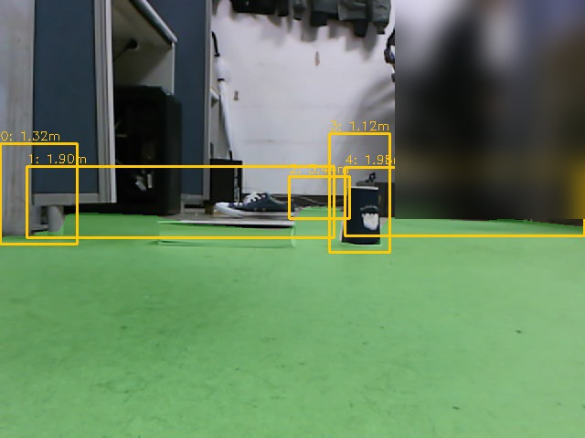
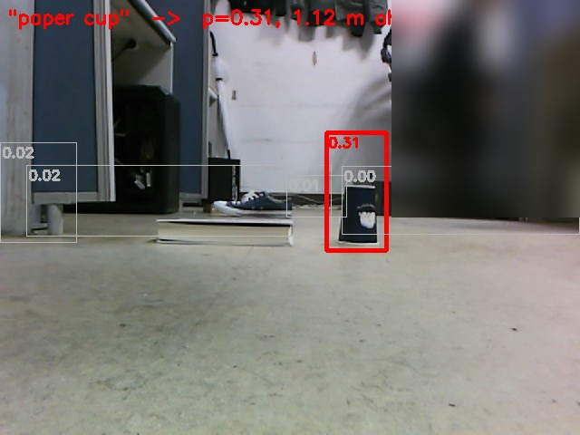

# Text로 지목한 물체 앞에 서기 (modular VLA)

"종이컵 앞에 서"처럼 text로 지목한 물체 앞으로 가게 해 봤다. Action token을 출력하는 E2E VLA 모델이 아니라, modular 방식을 이용하였다.

1. 출발선에서 사진 한 장과 지도 위치를 찍는다 (`robot/vla/snap.py`)
2. Floor segmentation 결과에서 바닥이 아닌 덩어리를 물체 후보로 자른다 (`vla_proposals.py`)
3. CLIP(ViT-B/16)으로 text와 가장 잘 맞는 후보를 고른다. CLIP은 가운데 정사각형만 보기 때문에 넓은 후보는 정사각형으로 채워서 넣었다 (`vla_ground.py`)
4. 고른 후보의 접지점을 바닥 좌표에서 지도 좌표로 바꾸고, 물체 0.35 m 앞을 Nav2 목표로 보낸다

| Floor segmentation으로 자른 물체 후보 | CLIP이 고른 후보 (종이컵, 0.31) |
|---|---|
|  |  |

| 폴더 | Text | CLIP | 결과 |
|---|---|---|---|
| [155016](155016) | 주황 상자 | 0.30 넘는 후보 없음 | 목표를 만들지 않음 |
| [160315](160315) | 검은 상자 | 0.43 | 내가 놓은 상자는 신발 뒤에 가려 후보가 아니었고, 의자 밑의 다른 검은 물체를 골랐다. 주행 안 함 |
| [160403](160403) | 신발 (17회차) | 0.63 | 맞게 골랐지만 신발이 책 바로 뒤라 목표점이 장애물 팽창 영역 사이에 끼어 global planner가 길을 못 찾고 포기 |
| [160712](160712) | 종이컵 (18회차) | 0.31 | 3.5초 만에 컵 앞에서 정지. 처음부터 끝까지 이어진 첫 성공 |

인식 쪽(후보 자르기와 고르기)은 대체로 됐고, 막힌 곳은 Nav2 이동이었다. 종이컵 점수가 0.31로 낮은 건 컵 후보에 옆의 책이 같이 잘려 들어갔기 때문이다.

사진은 로봇 카메라 원본에 그린 것으로, `proposals_vis.jpg`는 floor segmentation(초록)과 물체 후보 상자, `goal_point_vis.jpg`는 후보마다 CLIP 점수와 고른 후보(빨강)다. 뒤쪽 책상에 앉은 사람은 흐리게 처리했다. 각 폴더의 `proposals.json`은 후보 상자와 로봇 기준 위치, `goal_point.json`은 고른 후보와 지도 위 목표점이다.
