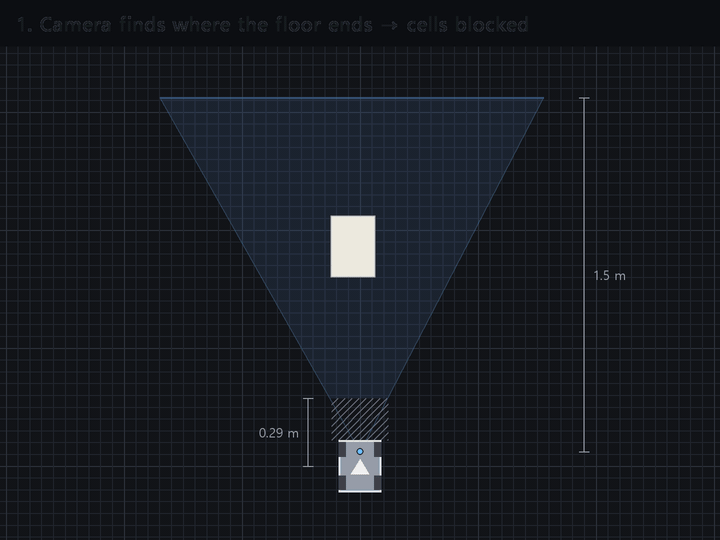

# robot

로봇(MentorPi M1, Raspberry Pi 5)의 ROS 2 Humble 컨테이너에서 도는 코드다. colcon 패키지로 묶지 않고 컨테이너 안에서 스크립트로 띄웠다.

| 파일 | 하는 일 |
|---|---|
| `floor_seg_node.py` | 인식 노드에 해당. 카메라 영상을 바닥 / 바닥 아님으로 나누고(INT8 ONNX, 240×320 입력), 화면 column마다 바닥이 끊기는 point를 로봇 앞 바닥 좌표로 바꿔 point cloud를 만든다 |
| `floor_watchdog.py` | 감시 노드에 해당. 인식 결과가 끊기거나 늦으면 Collision Monitor 정지 구역 안에 point를 넣어 로봇을 세운다 |
| `run_floor_seg.sh` | 두 노드를 시작·정지하고 상태를 확인한다 |
| `nav2_cam/` | 기존 Nav2 설정을 읽어서 카메라 층과 Collision Monitor를 붙인 사본을 만든다. 원래 파일은 고치지 않는다 |
| `offload/offload_pc.py` | 추론을 PC에서 할 때 PC 쪽 서버를 담당한다 |
| `vla/` | text로 지목한 물체 앞으로 가기 (floor segmentation 후보 + CLIP) |
| `tools/` | LiDAR 스캔을 지도에 맞춰(scan matching) 위치 다시 잡기, TF 시각 점검, 감시 노드 점검, 깊이 카메라로 거리 확인, 카메라 밝기 기록 |

## 토픽

- `/floor_obstacles/points` (base_footprint): 지금 프레임에서 찾은 장애물 point
- `/floor_obstacles/memory` (odom): blind-spot memory의 정보까지 합친 장애물 point. 지금 보이는 영역은 매 프레임 새 관측으로 바꾸고, 사각지대와 화면 밖의 point는 기억해 둔다. 기억한 point는 로봇이 10초 동안 움직이면 지운다. 프레임 사이에 0.5 cm 또는 0.6° 넘게 움직였을 때만 시간을 세서, 서 있는 동안은 지워지지 않게 했다.
- `/floor_obstacles/clearing` (base_footprint): Nav2가 코스트맵의 예전 장애물 표시를 지우는 데 쓰는 끝점. Nav2는 카메라에서 이 끝점까지 그은 선 위의 표시를 지운다. 장애물이 없는 column도 인식 범위 끝에 끝점을 내야, 치운 장애물의 표시가 코스트맵에서 지워진다.
- `/floor_obstacles/front_distance`: 로봇 폭 안에서 가장 가까운 장애물까지 거리
- `/floor_obstacles/watchdog`: 감시 노드 출력. 평소엔 비어 있고, 이상하면 정지 구역 안에 point가 생긴다



코스트맵을 위에서 내려다본 그림이다. 빨간 칸은 막힘, 초록 칸은 광선이 지나가 비어 있다고 확인된 칸, 빗금은 카메라가 못 보는 사각지대다. 칸을 막는 건 `/floor_obstacles/memory`, 지우는 건 `/floor_obstacles/clearing`이다. 카메라에서 0.23 m 안과 로봇 외곽 아래는 지우지 않아서, 사각지대에 들어간 장애물도 기억한 point로 막힌 채 남는다.

카메라 보정값(바닥에서 0.106 m 떠 있고, 아래로 2.45°를 바라보고 있음)과 경계 규칙(column마다 아래에서 위로 '바닥 아님'이 3픽셀 이어지는 첫 지점), 인식 범위(카메라에서 1.5 m)는 노드 파라미터다. 카메라 바로 앞 바닥은 로봇 중심에서 0.287 m 안쪽부터 안 보인다.

## Nav2를 이용하면서 겪었던 문제

- Blind-spot memory의 point cloud는 odom 좌표라서 관측 소스에 `sensor_frame`을 넣어 거리 제한을 센서 위치에서 재게 해야 한다. 빠뜨리면 Nav2가 거리 제한을 odom 원점에서 측정해서, 로봇이 원점에서 멀어질수록 장애물이 코스트맵에서 빠진다.
- 인식 노드를 끄면 카메라 층이 갱신되지 않은 것으로 보여 Nav2 제어기가 계속 기다린다. LiDAR only 조건은 노드를 끄지 않고 `mute` 파라미터로 출력만 비웠다.
- Collision Monitor는 오래된 소스를 무시한다. 감시 노드는 base_footprint 좌표로 내서 TF가 밀려도 바로 쓰이게 했다.
- 복구 action(behavior_server)은 Collision Monitor를 거치지 않고 cmd_vel을 바로 낸다.

## 실행

```bash
bash nav2_cam/nav_cam.sh start room_v2   # 제조사 기본 구동을 내리고 Nav2 + Collision Monitor 시작
bash run_floor_seg.sh start              # 인식 노드 + 감시 노드
bash nav2_cam/nav_cam.sh stop            # 끝나면 기본 구동으로 되돌림
```

onnxruntime은 시스템 numpy를 건드리지 않으려고 따로 둔 폴더를 PYTHONPATH로 넣었다(`run_floor_seg.sh`). 모델 파일은 저장소에 없다.
